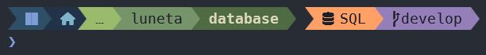
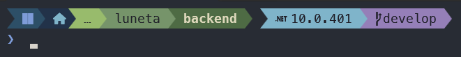

# Andenes

An [Oh My Posh](https://ohmyposh.dev) theme inspired by the Andean terraces.






[English](#overview) · [Español](#español)

## Overview

*Andenes* are the agricultural terraces built by the Incas along the slopes of the Andes.
This theme borrows that idea: the current path is split into individual steps that descend
from light to dark green, so the folder you are in always stands out as the deepest terrace.

Runtime and repository information is separated from the path by a small gap, making it clear
which segments describe *where* you are and which describe *what* the folder contains.

The color palette is based on [Kanagawa](https://github.com/rebelot/kanagawa.nvim).

## Segments

| Segment | Description |
|---|---|
| OS | Operating system icon |
| Home | Shown when the current path is inside your home directory |
| Path | Split into `…` › parent › current folder, from light to dark green |
| Runtimes | .NET, Node.js, Python, PHP and Java versions, shown only when the project uses them |
| SQL | Shown in folders containing `.sql` files |
| Git | Current branch |

## Requirements

- [Oh My Posh](https://ohmyposh.dev/docs/installation/windows)
- A [Nerd Font](https://www.nerdfonts.com/) v3, set as your terminal font

## Installation

No download is required. Point your shell to the theme URL:

**bash / Git Bash** (`~/.bashrc`)

```bash
eval "$(oh-my-posh init bash --config https://raw.githubusercontent.com/TU_USUARIO/andenes-oh-my-posh/main/andenes.omp.json)"
```

**zsh** (`~/.zshrc`)

```zsh
eval "$(oh-my-posh init zsh --config https://raw.githubusercontent.com/TU_USUARIO/andenes-oh-my-posh/main/andenes.omp.json)"
```

**PowerShell** (`$PROFILE`)

```powershell
oh-my-posh init pwsh --config https://raw.githubusercontent.com/TU_USUARIO/andenes-oh-my-posh/main/andenes.omp.json | Invoke-Expression
```

Restart your terminal to apply the changes.

## Optional: bash extras

The theme works on its own in any shell. For bash and Git Bash users, the
[`andenes.bash.sh`](andenes.bash.sh) file adds two improvements:

- **Smart SQL detection.** By default, the SQL segment appears when the current folder contains
  `.sql` files. With this script, it appears when **most** tracked files in the folder and its
  subfolders are `.sql`, so database projects are detected even if scripts live in subfolders.
- **UTF-8 locale.** Fixes the repeated-characters issue that Git Bash shows with some prompt symbols.

### Setup

1. Download [`andenes.bash.sh`](andenes.bash.sh) to your home folder.
2. Load it in your `~/.bashrc`, **after** the Oh My Posh line:

```bash
eval "$(oh-my-posh init bash --config https://raw.githubusercontent.com/TU_USUARIO/andenes-oh-my-posh/main/andenes.omp.json)"
source ~/andenes.bash.sh
```

> **Important:** the order matters. Oh My Posh defines an empty `set_poshcontext` function
> during initialization. If the script is loaded before it, Oh My Posh overwrites it and the
> SQL detection will not work.

The detection uses `git ls-files`, so it only applies inside Git repositories and ignores
anything listed in `.gitignore`. Results are cached per folder.

## Color palette

| Element | Color |
|---|---|
| OS | `#2D4F67` |
| Home | `#223249` |
| Path (light → dark) | `#98BB6C` · `#76946A` · `#4E6B44` |
| .NET | `#7FB4CA` |
| Node.js | `#C0A36E` |
| SQL | `#FFA066` |
| Git | `#957FB8` |

## License

[MIT](LICENSE) © Cristhian

---

## Español

**Andenes** es un tema para [Oh My Posh](https://ohmyposh.dev) inspirado en las terrazas
agrícolas incas. La ruta se divide en escalones que van de verde claro a oscuro, y la
información del proyecto (versiones, SQL y rama) se separa con un espacio.

### Instalación

No necesitas descargar nada. Agrega la línea correspondiente a tu shell (ver
[Installation](#installation)) y reinicia la terminal.

### Extras para bash (opcional)

El archivo [`andenes.bash.sh`](andenes.bash.sh) mejora la detección de SQL (considera
subcarpetas) y corrige las letras repetidas en Git Bash. Descárgalo a tu carpeta de usuario
y cárgalo en tu `~/.bashrc` **después** de la línea de Oh My Posh:

```bash
source ~/andenes.bash.sh
```